# LeadFlow

**A single-screen CRM for sales reps: track leads, log every discussion, and never miss a follow-up.**

This repository is the **Next.js frontend**. The API lives in **[lead_flow_backend](https://github.com/Shantanu700/lead_flow_backend)** (Django REST Framework, PostgreSQL, Redis). The app needs both; [Getting Started](#getting-started) runs them together. The original product brief and acceptance checklist are in [docs/SPEC.md](docs/SPEC.md).

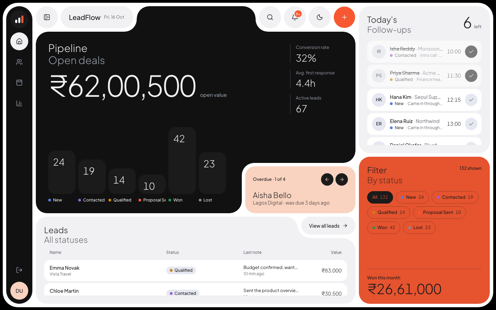

## Screenshots

| Lead drawer: timeline, status, new note with follow-up | Add lead |
|---|---|
| 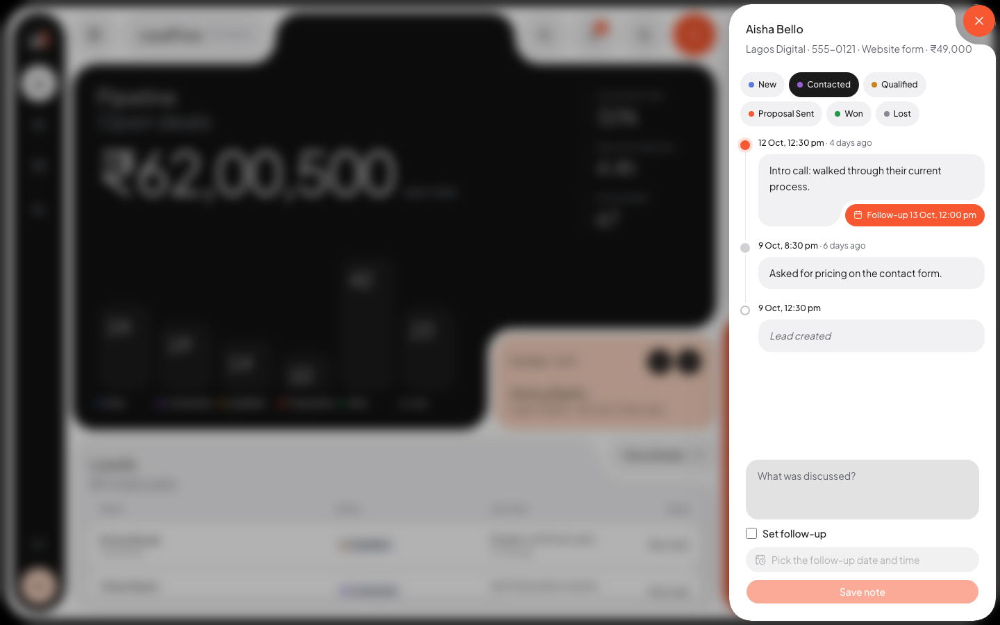 | 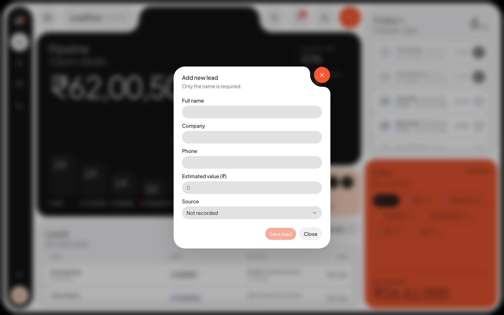 |
| **Leads: status filter, search, sort, paging** | **Follow-ups: today, upcoming, overdue** |
| 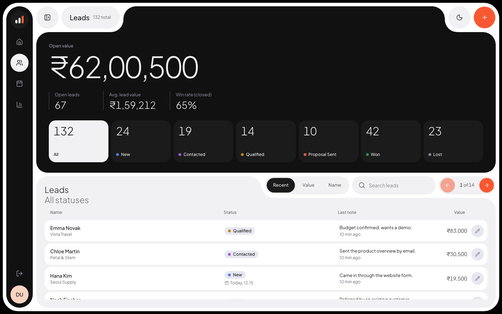 | 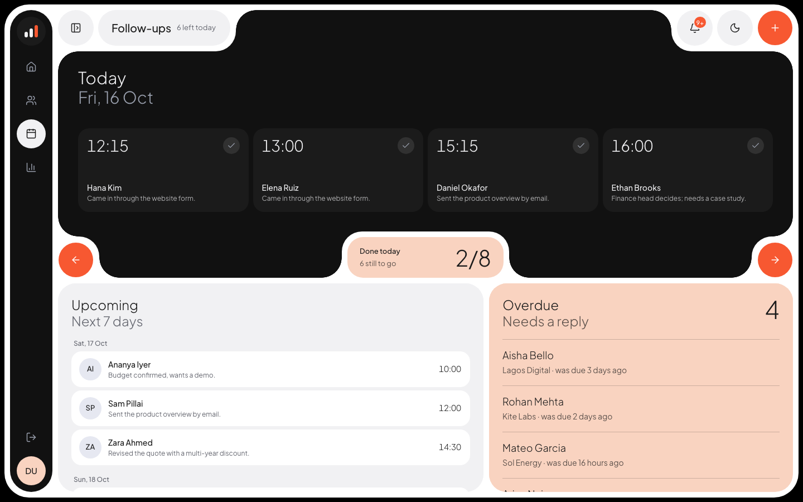 |
| **Reports: revenue, win rate, funnel, sources** | **Search palette (⌘K)** |
| 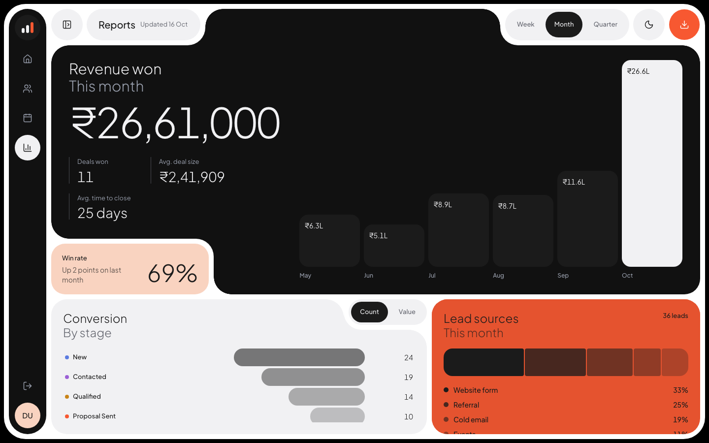 | 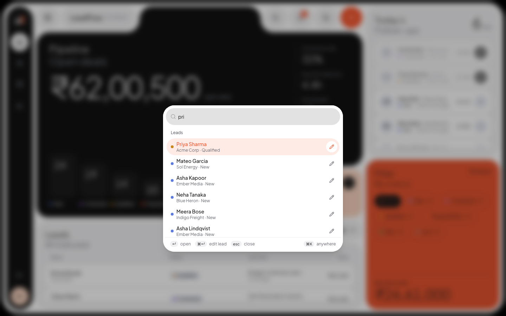 |
| **Dark theme** | **Sign in** |
| 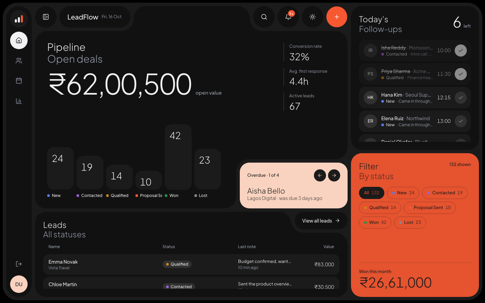 | 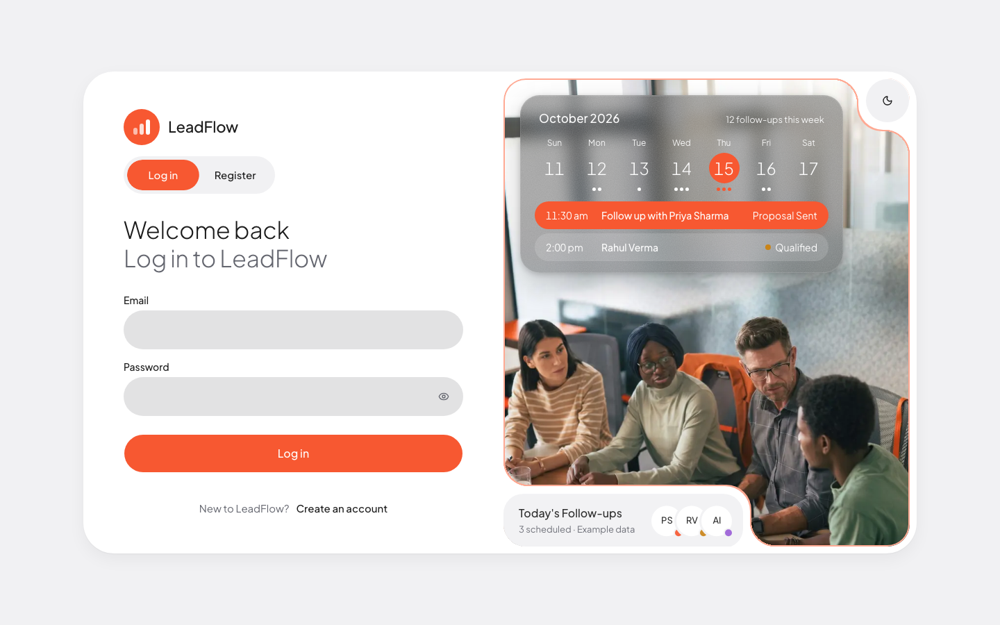 |

On phones the side rail becomes a bottom tab bar and every tab stacks into one scrolling column:

<p>
  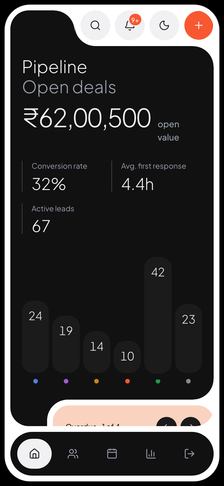
  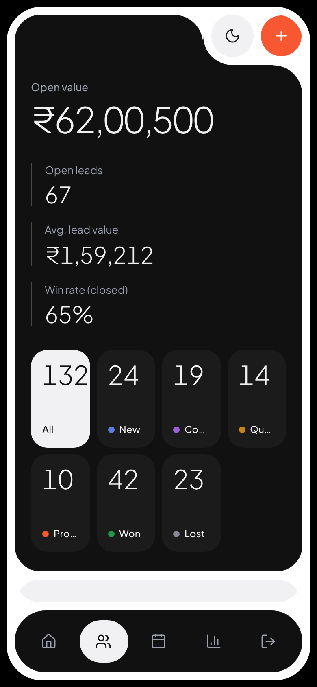
</p>

## Features

**Core flows (from the brief)**
- **Lead list:** every lead shows its name, company, status badge, latest discussion note and how long ago it was ("2 hours ago").
- **Status filter:** All, New, Contacted, Qualified, Proposal Sent, Won and Lost. Filtering happens on the server.
- **Today's follow-ups:** a pinned section with each lead's company, status, last note and follow-up time. Tick a follow-up off when it's done. "Today" uses the app's timezone (Asia/Kolkata).
- **Lead drawer (on the same screen, never a new page):**
  - The discussion history, newest first, on a timeline. Each note shows its time and how long ago; a note that scheduled a follow-up shows it in an orange pill.
  - A note form with an optional follow-up date and time.
  - Status changes, saved straight to the server.
  - A saved note or status change shows in the list immediately.
- **Add lead:** the name is required (spaces alone are rejected); company, phone, estimated value and source are optional. New leads always start as New.
- **Errors:** saves show only what the server confirmed. A failed save shows a warning or error toast and keeps what you typed.

**Beyond the brief**
- **Search** by name, company, phone or latest note, from the Leads tab or the ⌘K search palette.
- **Overdue follow-ups** highlighted on the dashboard (a card you can step through) and on the Follow-ups tab.
- **Sorting and paging:** by recent activity, value or name.
- **Reports:** revenue won by week, month or quarter, win rate against the previous period, a conversion funnel, lead sources, and CSV export.
- **Notification bell:** lists the follow-ups that need you.
- **Edit leads** from the Leads tab.
- **Light and dark themes** (press `d`), a phone layout, and animated tab switches that respect reduced motion.
- **Backend:** Docker Compose dev stack and a seed command with realistic sample data and a demo login (see the backend README).

## Tech stack

| Layer | Choice |
|---|---|
| Frontend | Next.js 16 (App Router), React 19, TypeScript |
| UI | Tailwind CSS v4, shadcn/ui on Base UI, lucide icons, GSAP for animation, Sonner toasts |
| API client | Generated from the backend's OpenAPI schema with `@hey-api/openapi-ts` (`src/client/`) |
| Backend | Django 6 + Django REST Framework, PostgreSQL 17, Redis 8, Celery (separate repo) |
| Auth | Email and password with a Django session cookie; both servers run over HTTPS on localhost |

The brief preferred Next.js with a Python backend; Django REST Framework was used for its built-in auth, admin and migrations.

## Getting Started

### Prerequisites

- [Git](https://git-scm.com)
- [Docker](https://docs.docker.com/get-docker/) with Docker Compose (runs the backend, Postgres and Redis)
- [Bun](https://bun.sh) (the frontend's package manager)
- [mkcert](https://github.com/FiloSottile/mkcert) (local HTTPS certificates that browsers trust)

### Steps

1. **Clone both repositories side by side:**
   ```bash
   mkdir leadflow && cd leadflow
   git clone https://github.com/Shantanu700/lead_flow_backend.git backend
   git clone https://github.com/Shantanu700/lead_flow_frontend.git frontend
   ```
2. **Trust local HTTPS certificates** (once per machine; it may ask for your password):
   ```bash
   mkcert -install
   ```
3. **Start the backend:**
   ```bash
   cd backend
   cp .env.example .env
   # Set DJANGO_SECRET_KEY in .env, e.g. to the output of:
   python3 -c "import secrets; print(secrets.token_urlsafe(50))"
   mkdir -p certs
   mkcert -cert-file certs/localhost.pem -key-file certs/localhost-key.pem localhost 127.0.0.1 ::1
   docker compose -f docker/dev/docker-compose.yml up -d --build
   docker logs -f leadflow_dev_web   # wait for "Starting development server", then Ctrl+C
   ```
   The first start creates the database, runs the migrations, loads sample data and prints the demo login (`demo@example.com` and its password; set `DEMO_PASSWORD` in `.env` beforehand to choose it). The API is at https://localhost:8011, with docs at https://localhost:8011/api/schema/swagger-ui/.
4. **Start the frontend** (in a second terminal, from the `leadflow` folder):
   ```bash
   cd frontend
   cp .env.example .env.local
   bun install
   mkdir -p certificates
   mkcert -cert-file certificates/localhost.pem -key-file certificates/localhost-key.pem localhost 127.0.0.1 ::1
   bun dev
   ```
5. **Open https://localhost:3000** and sign in as `demo@example.com` with the password from step 3, or register a new account.

### Environment variables

| Variable | Where | Purpose |
|---|---|---|
| `NEXT_PUBLIC_API_URL` | `.env.local` (from `.env.example`) | The backend API. Defaults to `https://localhost:8011`. |

The backend's variables are listed in its own `.env.example`.

### Stopping and resetting

```bash
cd backend
docker compose -f docker/dev/docker-compose.yml down      # stop; the data is kept
docker compose -f docker/dev/docker-compose.yml down -v   # stop and delete the database
docker exec leadflow_dev_web python manage.py seed_fixtures --reset   # fresh sample data
```

### Scripts

```bash
bun dev               # HTTPS dev server on https://localhost:3000
bun run build         # production build
bun run typecheck     # TypeScript
bun run lint          # ESLint
bun run format        # Prettier
bun run openapi-ts    # regenerate src/client/ from the running backend's schema (never edit it by hand)
```

## Project structure

```text
app/
  auth/                 sign-in / register page
  dashboard/
    page.tsx            the frame: rail, content area, drawer, dialog, palette
    use-dashboard.ts    state, data loading and save handlers (shared via context)
components/
  dashboard/
    views/              one file per tab: overview, leads, follow-ups, reports
    lead-sheet.tsx      lead drawer: timeline, status, note form
    lead-dialog.tsx     add / edit lead
    lead-table.tsx      the lead rows
    rail.tsx            side rail (bottom tab bar on phones)
    chrome.tsx          buttons and figures shared by the tabs
  command-palette.tsx   ⌘K search
  date-time-picker.tsx  follow-up date and time
  notch.tsx             the corner cut-outs that hold controls
  ui/                   shadcn/ui components
hooks/                  tab-switch and in-place animations (GSAP)
lib/                    API setup and errors, formatting (₹, dates), constants, layout
src/client/             generated API client
docs/                   SPEC.md (the brief) and screenshots
```

## How this differs from the suggested API contract

- Updates use `PUT /api/leads/{id}/` (not `PATCH`).
- `GET /api/leads/` is paginated (`page`, `page_size` up to 50) and also takes `status`, `q` (searches name, company, phone and the latest note) and `ordering=recent|value|name`.
- Leads also carry an estimated `value` (₹) and a `source`.
- Extra endpoints: `/api/follow-ups/overdue/`, `/api/follow-ups/upcoming/`, and per-tab figures at `/api/stats/dashboard|leads|reports/`.
- Sign-in is required (the brief made it optional); a demo account is seeded.

## Testing

- **Backend:** a pytest suite covers auth, leads, discussions, follow-ups, stats and the seed data. Run it with `docker exec leadflow_dev_web python -m pytest`.
- **Frontend:** every change was checked with `typecheck`, `lint` and `build`, then in a real browser at desktop and phone widths with Playwright scripts. Those scripts exercised the checklist in [docs/SPEC.md](docs/SPEC.md), the save and error paths, and the animations. They were run locally and are not part of this repo.

## Use of AI

This project was built with **[Claude Code](https://claude.com/claude-code)** (Anthropic) as an AI pair programmer, as the brief encouraged. Claude Code wrote most of the code, tests, docs and commit messages from my instructions and design decisions, and ran the checks described above. Commits it authored carry a `Co-Authored-By: Claude` trailer, and its pull requests say "Generated with Claude Code".
